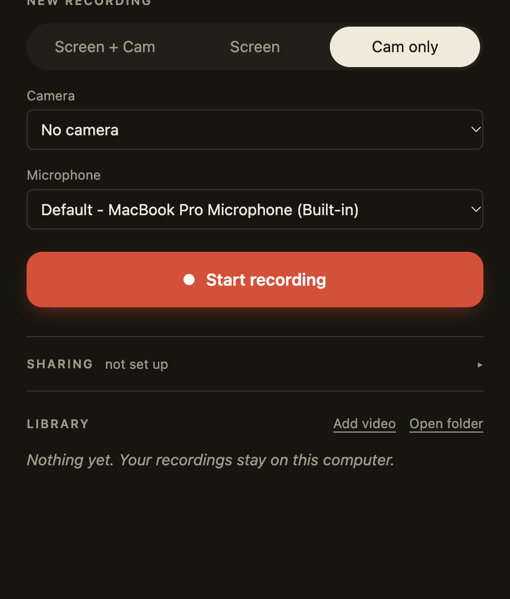
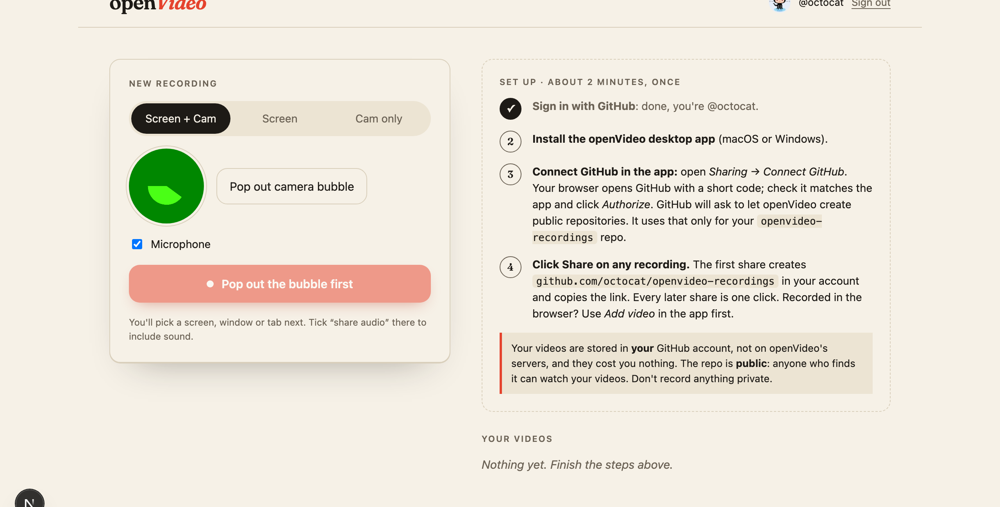

<div align="center">


# openVideo

**Record your screen and face. Send a link. Keep the video.**

The open-source async video recorder for macOS and Windows: a camera bubble, drawing on screen, and one-click share links. Videos are stored **in your own GitHub account**, so they cost nothing and stay yours.

[](https://github.com/SyedBahjat/openVideo/actions/workflows/ci.yml)
[](LICENSE)

[](https://github.com/SyedBahjat/openVideo/stargazers)

[**Install**](#install) · [**Website**](https://open-video-rose.vercel.app) · [Deploy the website](#deploy-the-website-to-vercel) · [How it works](#how-it-works) · [Loom teardown](docs/EVIDENCE.md)

&nbsp;&nbsp;

</div>

## Why openVideo

- **Free, with no account limits.** No 5-minute cap, no "upgrade to keep your videos". Recordings live on your disk, and shared videos live in your own GitHub repo.
- **Your data stays yours.** openVideo has no video servers at all. Each shared video is a release in `github.com/<you>/openvideo-recordings`.
- **Works like the tools you know.** Camera bubble, countdown, pause/resume/restart, drawing, a global shortcut, and a link in your clipboard the moment you share.
- **Small, readable code.** Plain Electron + vanilla JS for the desktop app, and Next.js for the site. No native code to compile.

## Features

| | Desktop app (macOS, Windows) | Website (any modern browser) |
|---|---|---|
| Screen + camera, screen only, camera only | ✅ any display or window | ✅ any screen, window or tab |
| Floating camera bubble that appears in the video | ✅ draggable circle | ✅ Picture-in-Picture window |
| Countdown, pause / resume / restart / cancel, timer | ✅ floating control bar, hidden from the recording | ✅ pause / resume |
| Draw on screen while recording | ✅ <kbd>⌘/Ctrl</kbd>+<kbd>⇧</kbd>+<kbd>D</kbd>, 4 colours | — |
| Mic + system audio | ✅ mixed into one track | ✅ mic + tab/system audio |
| Start/stop shortcut | ✅ <kbd>⌘/Ctrl</kbd>+<kbd>⇧</kbd>+<kbd>L</kbd> | — |
| Output | H.264/AAC MP4, written to disk every second (crash-safe) | MP4 or WebM download |
| One-click share link (saved to your GitHub) | ✅ | via *Add video* in the app |
| Library | ✅ play, show in folder, copy path, trash | ✅ your shared videos |


## Install

**macOS** (Apple silicon or Intel). Paste this into Terminal:

```sh
curl -fsSL https://raw.githubusercontent.com/SyedBahjat/openVideo/main/install.sh | bash
```

It downloads the latest release, puts openVideo in Applications and opens it ([read the script](install.sh)). On first launch, allow Camera, Microphone and **Screen Recording** (System Settings → Privacy & Security), then reopen the app.

<details>
<summary>Prefer the .dmg? Read this first</summary>

openVideo isn't notarized by Apple yet, so macOS blocks it when a browser downloads it ("openVideo is damaged" or "Apple could not verify…"). After dragging it to Applications, run this once to unblock it:

```sh
xattr -cr /Applications/openVideo.app
```

This only removes the "downloaded from the internet" flag. Notarized builds, which need no workaround, are on the roadmap.
</details>

**Windows:** download `openVideo-Setup-x.y.z.exe` from **[Releases](https://github.com/SyedBahjat/openVideo/releases/latest)**. On the SmartScreen prompt, click **More info** → **Run anyway**.

Or run from source:

```sh
git clone https://github.com/SyedBahjat/openVideo.git && cd openVideo
npm install
npm start
```

## Share links: how storage works

1. In the app, open **Sharing** → **Connect GitHub**. Your browser opens GitHub with a short code. Check that it matches the app and click **Authorize**.
2. Click **Share** on any recording. The first share creates the public repo `openvideo-recordings` in **your** account. The video is uploaded as a release asset (up to 2 GB per file), and a link like `https://<site>/v/gh/<you>/<id>` is copied to your clipboard.

> [!IMPORTANT]
> The repo is **public**, which is what makes storage free and lets anyone with the link watch. Don't share anything private. Delete a video by deleting its release on GitHub.

The GitHub token is stored encrypted with the OS keychain (Keychain on macOS, DPAPI on Windows), and the app only asks for the `public_repo` scope.

## Deploy the website to Vercel

The website (in [`web/`](web)) provides GitHub sign-in, a setup guide, browser recording, the user's video list, and the watch page behind every share link.

[](https://vercel.com/new/clone?repository-url=https%3A%2F%2Fgithub.com%2FSyedBahjat%2FopenVideo&root-directory=web&env=GITHUB_CLIENT_ID,GITHUB_CLIENT_SECRET,SESSION_SECRET&envDescription=GitHub%20OAuth%20App%20credentials%20and%20a%2032%2B%20character%20session%20secret&envLink=https%3A%2F%2Fgithub.com%2FSyedBahjat%2FopenVideo%2Ftree%2Fmain%2Fweb%23setup)

1. **Create a GitHub OAuth App** at [github.com/settings/applications/new](https://github.com/settings/applications/new):
   - Homepage: `https://<your-domain>`. Callback: `https://<your-domain>/api/auth/callback`.
   - Tick **Enable Device Flow**, since the desktop app signs in with the same Client ID.
2. **Import this repo in Vercel**, set **Root Directory** to `web`, and add the environment variables:

   | Variable | Value |
   |---|---|
   | `GITHUB_CLIENT_ID` | from the OAuth App |
   | `GITHUB_CLIENT_SECRET` | from the OAuth App |
   | `SESSION_SECRET` | `openssl rand -base64 32` |
   | `GITHUB_TOKEN` *(optional)* | a token with no scopes; raises the GitHub API limit from 60 to 5,000 requests/hour |
   | `DESKTOP_DOWNLOAD_URL` *(optional)* | e.g. this repo's latest release page |

3. **Point the desktop app at your site:** set `SITE_URL` and `GITHUB_CLIENT_ID` in [`config.js`](config.js), or set `OPENVIDEO_SITE_URL` / `OPENVIDEO_GITHUB_CLIENT_ID` when building. The official builds use https://open-video-rose.vercel.app.

The site keeps no database and no stored GitHub tokens. Users only ever authorize; they never create apps or keys.

## How it works

openVideo follows the same architecture as Loom Desktop ([teardown with evidence](docs/EVIDENCE.md)). The difference is that it uses Chromium's built-in capture and hardware encoding instead of a custom native recorder:

```
 panel window ── getDisplayMedia / getUserMedia ──► MediaRecorder (1 s chunks) ──IPC──► main: append to ~/Movies/openVideo/*.mp4
   ├─ camera window    transparent, always on top  → captured in the video
   ├─ drawing overlay  transparent, click-through  → captured in the video
   ├─ control bar      content-protected           → hidden from the video
   └─ countdown        content-protected

 Share ── GitHub device flow ──► POST /repos/<you>/openvideo-recordings/releases ──► upload asset ──► https://<site>/v/gh/<you>/<id>
```

```
openVideo/
├── main.js, preload.js, renderer/   desktop app (Electron, vanilla JS)
├── share.js, lib.js                 GitHub sharing + validated helpers
├── web/                             website (Next.js 16, App Router)
└── docs/EVIDENCE.md                 how Loom Desktop records, from its public build
```

## Known limits

- **Window recordings don't include the camera bubble**, because it lives in its own window. Record a display instead.
- **System audio** is official on Windows; on macOS it's best effort (macOS 13+).
- **The website can't upload to GitHub directly**, because GitHub's upload endpoint blocks browser uploads. Record on the web, then use **Add video → Share** in the app.
- **GitHub can throttle or remove repos with excessive bandwidth** (Acceptable Use Policy §9). Treat it as free hosting, not a CDN.
- **Not yet:** click highlights, trimming, transcripts, uploading while recording.

## Contributing

Issues and PRs are welcome. See [CONTRIBUTING.md](CONTRIBUTING.md). If openVideo is useful to you, a ⭐ helps other people find it.

## License

[MIT](LICENSE). openVideo is an independent project, not affiliated with Loom or Atlassian.
